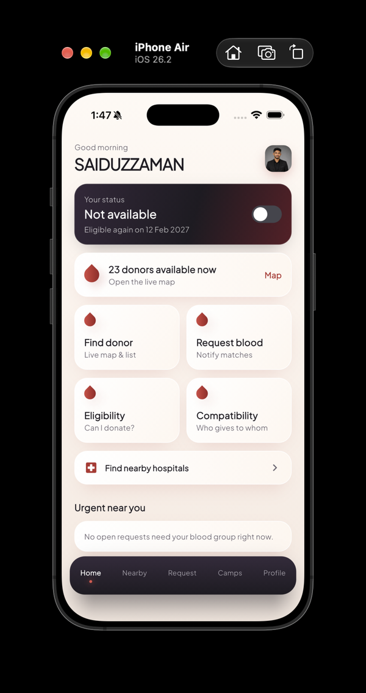
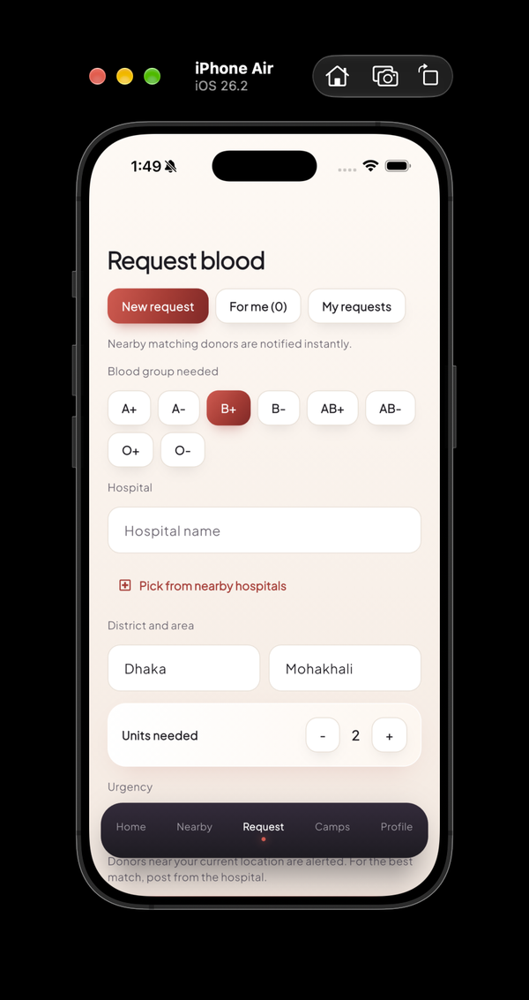
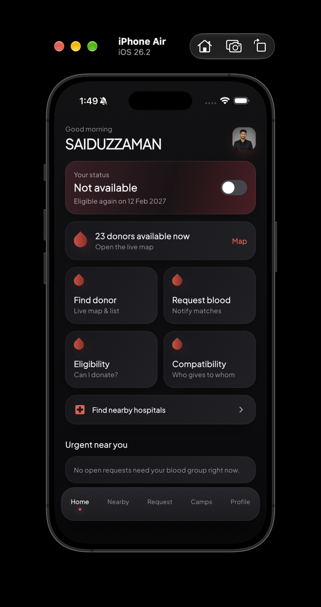
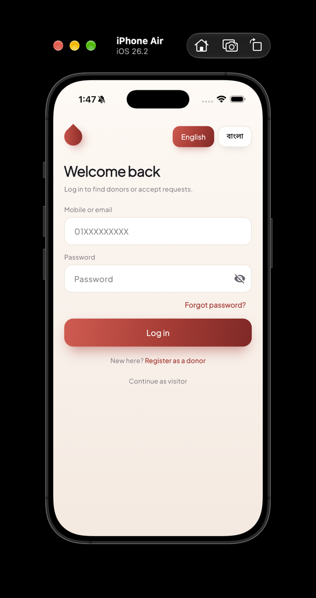
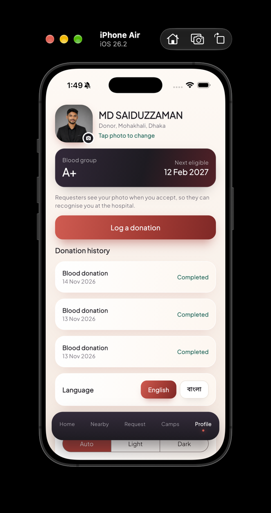
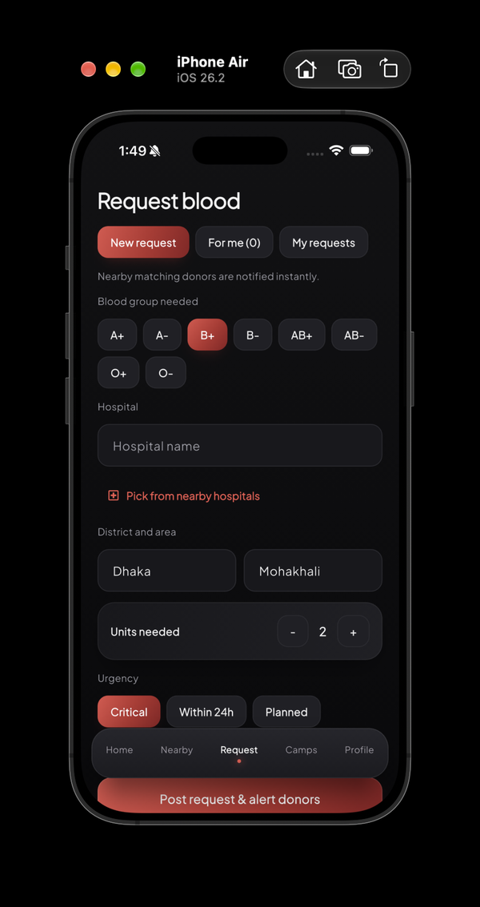
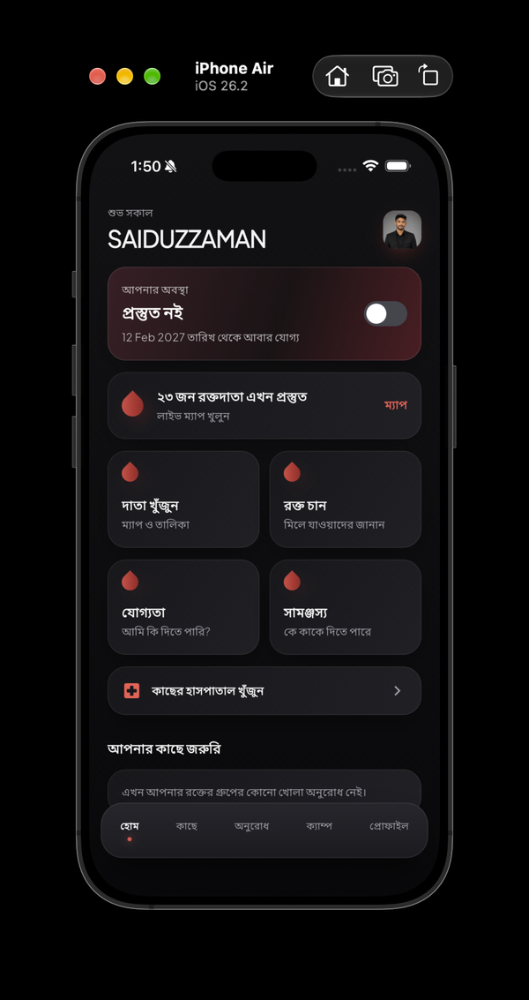
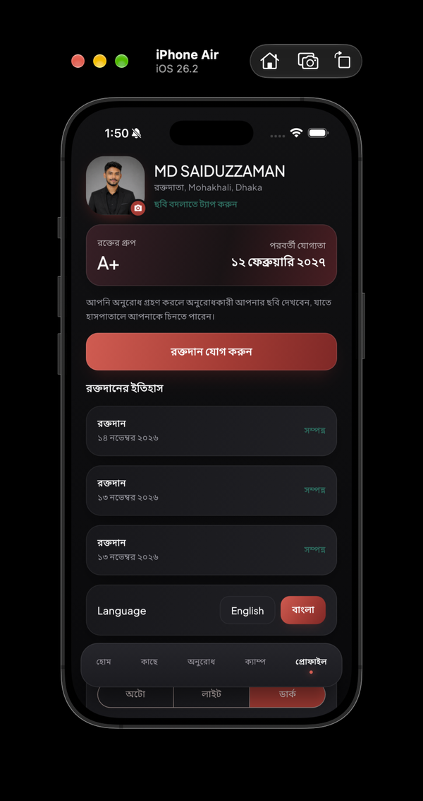

<div align="center">

# 🩸 Roktosheba

**Find voluntary blood donors near you, fast.**
A free, bilingual (Bangla + English) blood donor app for Bangladesh, built with Flutter and Firebase.

[](https://github.com/saiduzzaman-sojib/RoktoSheba/releases/latest)
[](https://github.com/saiduzzaman-sojib/RoktoSheba/releases)


[**⬇️ Download APK**](https://github.com/saiduzzaman-sojib/RoktoSheba/releases/latest) ·
[Features](#-features) ·
[Screenshots](#-screenshots) ·
[Getting started](#-getting-started)

<br>





</div>

---

## 📖 About

In an emergency, finding the right blood group quickly is the hard part. **Roktosheba** connects people who need blood with eligible, willing donors nearby. A requester posts a request, matching donors are alerted, and a donor's phone number is shared **only after they accept**.

The whole app runs on the **Firebase Spark (free) plan**: no Cloud Functions, no Storage, no Blaze billing.

> ⚠️ Roktosheba is not a blood bank and gives general information only. It does not replace medical advice. The final decision to donate is always made by the hospital or blood bank. In an emergency, call **999**.

## ✨ Features

| | |
|---|---|
| 🗺️ **Live donor map** | See available donors on a map, filter by blood group and distance (2.5 / 5 / 10 / 25 km). |
| 🆘 **Blood requests** | Post a request with blood group, units and urgency (Critical, Within 24h, Planned). Matching donors are notified. |
| 🏥 **Hospital finder** | Search nearby hospitals using OpenStreetMap data, call them or get directions, and pick one straight into a request. |
| ✅ **Eligibility check** | Tells a donor whether they can donate today and when they are next eligible. |
| 🔁 **Compatibility guide** | Quick "who can give to whom" reference for all 8 blood groups. |
| 📅 **Donation camps** | Upcoming camps with reminders and directions. |
| 📚 **Health tips and stories** | Donation tips, myths and donor stories. |
| 🤖 **Response predictor** | A small on-device model estimates how likely a donor is to respond (trained on simulated data, see [limitations](#-limitations)). |
| 🌐 **Bangla and English** | Full Bangla UI with Bangla digits and dates, switchable any time. |
| 🌙 **Light and dark mode** | Auto, Light or Dark. |
| 🔒 **Privacy and safety** | Contact details are private until accepted, abuse reporting, and a request rate limit. |
| 👋 **Onboarding and Terms** | First-run intro and a clear Terms & Privacy summary the user must accept. |

## 📸 Screenshots

### Light

<div align="center">




</div>

### Dark

<div align="center">



</div>

### বাংলা (Bangla)

<div align="center">


</div>

## 🧰 Tech stack

| Area | Choice |
|---|---|
| Framework | Flutter (Dart), Material 3 |
| State management | Riverpod 3 |
| Navigation | go_router (`StatefulShellRoute`, auth and Terms redirects) |
| Backend | Firebase Auth, Cloud Firestore (`asia-south1`) |
| Monitoring | Firebase Crashlytics and Analytics (release builds only) |
| Hospitals | OpenStreetMap Overpass API |
| Localization | Lightweight built-in `tr()` / `trp()` helpers with a Bangla string map |
| Theming | Custom light/dark theme extension, Google Fonts |

## 🏗️ Project structure

```
lib/
├── core/          # theme, router, l10n, shared widgets, services (telemetry), utils
└── features/      # auth, donors, requests, hospitals, camps, blog,
                   # eligibility, compatibility, safety, onboarding, splash, legal, profile
```

Each feature keeps its own `data/` and `presentation/` code.

## 🚀 Getting started

### Prerequisites
- [Flutter SDK](https://docs.flutter.dev/get-started/install) (stable)
- A Firebase project on the free Spark plan
- Firebase CLI and FlutterFire CLI

### Run it

```bash
git clone https://github.com/saiduzzaman-sojib/RoktoSheba.git
cd RoktoSheba
flutter pub get
```

Connect your own Firebase project (this repo does not ship private keys):

```bash
dart pub global activate flutterfire_cli
flutterfire configure
```

Enable **Email/Password** sign-in in Firebase Authentication and create a Firestore database. Then deploy the security rules:

```bash
firebase deploy --only firestore:rules
```

Run the app:

```bash
flutter run
```

### Build a release APK

Create your own keystore and an `android/key.properties` file (both are git-ignored, never commit them), then:

```bash
flutter build apk --release                 # universal APK
flutter build apk --release --split-per-abi # smaller per-architecture APKs
```

## 🔐 Security and privacy

- **Contact details are private.** A donor's phone number is stored in a separate document and revealed to the requester only after the donor accepts.
- **Server-enforced rate limit.** One blood request per 5 minutes per user, enforced by Firestore Security Rules (no Cloud Functions needed).
- **Abuse reporting.** Users can report a request or a donor. Reports are create-only, one per target, and readable only by admins.
- **Minimal telemetry.** Crash and usage data are collected only in release builds, never in debug.
- Release signing keys and `key.properties` are never committed.

## ⚠️ Limitations

- **No server-sent push notifications.** Alerts are in-app because background push needs Cloud Functions (Firebase Blaze plan). This is a deliberate trade-off to keep the app free.
- **The response predictor uses simulated data.** It is a demo of on-device ML, not a clinically validated model.
- Profile photos are stored as compressed base64 in Firestore to avoid paid Storage.
- Android is the primary tested release target. iOS builds run from source but are not distributed.

## 🗺️ Roadmap

- [ ] Admin dashboard tab for reviewing reports
- [ ] Unit tests for eligibility, matching and the predictor
- [ ] Push notifications (requires a paid Firebase plan)
- [ ] Play Store release

## 🤝 Contributing

Issues and pull requests are welcome. For larger changes, please open an issue first to discuss what you would like to change.

## 👤 Author

**Md Saiduzzaman**, [@saiduzzaman-sojib](https://github.com/saiduzzaman-sojib)

---

<div align="center">
Made with ❤️ in Bangladesh. Every donation can save a life. 🩸
</div>
