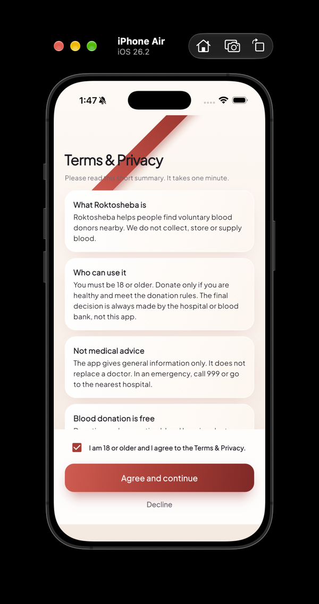
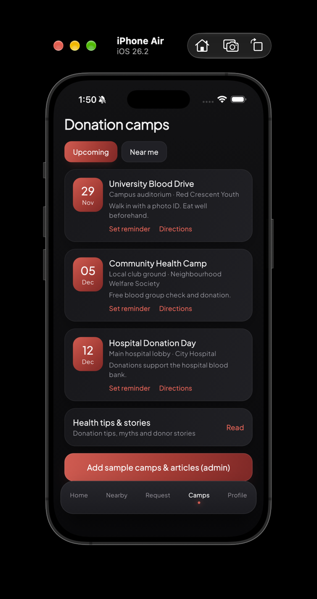

<div align="center">

# Roktosheba

Find voluntary blood donors near you, fast.
A free, bilingual (Bangla and English) blood donor app for Bangladesh.

[](https://github.com/saiduzzaman-sojib/RoktoSheba/releases/latest)
[](https://github.com/saiduzzaman-sojib/RoktoSheba/releases)


[Download](https://github.com/saiduzzaman-sojib/RoktoSheba/releases/latest) &nbsp;|&nbsp; [Features](#features) &nbsp;|&nbsp; [Screenshots](#screenshots) &nbsp;|&nbsp; [Getting started](#getting-started)

<br>

&nbsp;&nbsp;
&nbsp;&nbsp;


</div>

<br>

## About

In an emergency, finding the right blood group quickly is the hard part. Roktosheba connects people who need blood with eligible, willing donors nearby. A requester posts a request, matching donors are alerted, and a donor's phone number is shared only after they accept.

The app runs entirely on the Firebase Spark (free) plan, with no Cloud Functions, Storage or billing.

> Roktosheba is not a blood bank and gives general information only. It does not replace medical advice, and the final decision to donate is always made by the hospital or blood bank. In an emergency, call 999.

## Features

| Feature | Description |
|---|---|
| Live donor map | Available donors on a map, filtered by blood group and distance. |
| Blood requests | Post a request with blood group, units and urgency. Matching donors are notified. |
| Hospital finder | Nearby hospitals from OpenStreetMap, with call, directions and one-tap selection in a request. |
| Eligibility check | Shows whether a donor can donate today and when they are next eligible. |
| Compatibility guide | Quick reference for who can give to whom. |
| Donation camps | Upcoming camps with reminders and directions. |
| Health tips | Donation tips, myths and donor stories. |
| Response predictor | Small on-device model estimating donor response likelihood. See [limitations](#limitations). |
| Bangla and English | Full Bangla interface with Bangla digits and dates. |
| Light and dark theme | Auto, Light or Dark. |
| Privacy and safety | Private contact details, abuse reporting and a request rate limit. |

## Screenshots

**Light**

<table>
  <tr>
    <td align="center"><br><sub>Login</sub></td>
    <td align="center"><br><sub>Terms and Privacy</sub></td>
    <td align="center"><br><sub>Home</sub></td>
    <td align="center"><br><sub>Request blood</sub></td>
    <td align="center"><br><sub>Profile</sub></td>
  </tr>
</table>

**Dark**

<table>
  <tr>
    <td align="center"><br><sub>Home</sub></td>
    <td align="center"><br><sub>Request blood</sub></td>
    <td align="center"><br><sub>Donation camps</sub></td>
  </tr>
</table>

**Bangla**

<table>
  <tr>
    <td align="center"><br><sub>Home</sub></td>
    <td align="center"><br><sub>Profile</sub></td>
  </tr>
</table>

## Tech stack

| Area | Choice |
|---|---|
| Framework | Flutter (Dart), Material 3 |
| State management | Riverpod 3 |
| Navigation | go_router |
| Backend | Firebase Auth, Cloud Firestore |
| Monitoring | Firebase Crashlytics and Analytics (release builds only) |
| Maps and hospitals | flutter_map, OpenStreetMap Overpass API |
| Localization | Built-in `tr()` helpers with a Bangla string map |

## Project structure

```
lib/
  core/        theme, router, l10n, shared widgets, services, utils
  features/    auth, donors, requests, hospitals, camps, blog, eligibility,
               compatibility, safety, onboarding, splash, legal, profile
```

## Getting started

Requirements: Flutter (stable), a Firebase project on the Spark plan, Firebase CLI and FlutterFire CLI.

```bash
git clone https://github.com/saiduzzaman-sojib/RoktoSheba.git
cd RoktoSheba
flutter pub get
dart pub global activate flutterfire_cli
flutterfire configure
```

Enable Email/Password sign-in and create a Firestore database in your Firebase project, then deploy the rules and run the app:

```bash
firebase deploy --only firestore:rules
flutter run
```

To build a release APK, create your own keystore and `android/key.properties` (both are git-ignored), then:

```bash
flutter build apk --release
```

## Security and privacy

- A donor's phone number is stored in a separate document and revealed to the requester only after the donor accepts.
- One blood request per 5 minutes per user, enforced by Firestore Security Rules.
- Requests and donors can be reported. Reports are create-only, one per target, and readable only by admins.
- Crash and usage data are collected in release builds only.
- Signing keys and `key.properties` are never committed.

## Limitations

- No server-sent push notifications. Background push needs Cloud Functions (paid plan), so alerts are in-app.
- The response predictor is trained on simulated data. It demonstrates on-device ML and is not clinically validated.
- Profile photos are stored as compressed base64 in Firestore to avoid paid Storage.
- Android is the tested release target. iOS runs from source but is not distributed.

## Roadmap

- Admin screen for reviewing reports
- Unit tests for eligibility, matching and the predictor
- Play Store release

## Contributing

Issues and pull requests are welcome. For larger changes, please open an issue first.

## Author

Md Saiduzzaman, [@saiduzzaman-sojib](https://github.com/saiduzzaman-sojib)
